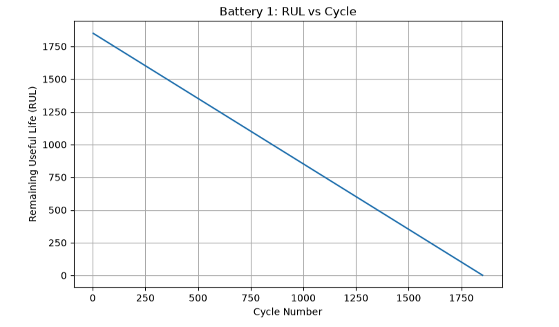

This graph shows the degradation behavior of an individual lithium-ion battery over its cycling lifetime. We can observe how the State of Health changes as the number of charge-discharge cycles increases. The decreasing trend indicates capacity degradation with repeated cycling. This preliminary analysis helps us establish the relationship between battery usage and health before applying machine-learning models.

Before training the neural network, we first analyzed the underlying degradation behavior in the dataset. This allows us to verify that the processed data preserves the expected physical behavior of battery aging.

The next stage is to use the extracted battery-health features as inputs to a baseline neural network and evaluate whether the model can learn this degradation behavior and predict battery health.

The processed dataset shows the expected battery degradation behavior. We can see a clear decreasing trend in the State of Health (SOH) as the number of cycles increases, which aligns with the expected physical degradation patterns of lithium-ion batteries.

The original Severson dataset contains 124 commercial LFP/graphite cells, cycled under fast-charging conditions, with cycle lives ranging roughly from 150 to 2,300 cycles.
Each battery was repeatedly charged/discharged, producing many cycle records.

why split the batteries?

Battery degradation is a time-dependent trajectory, so cycle 500 and cycle 501 from the same cell are extremely related.

The Severson dataset contains 124 LFP/graphite lithium-ion cells, with multiple charge-discharge cycles recorded for each cell. Since individual cycle records from the same battery are highly correlated, we avoid randomly splitting individual cycles because that can cause data leakage. Instead, we perform the train, validation and test split at the battery level, so all cycles from a particular battery remain in the same subset. The training batteries are used to learn the degradation relationship, validation batteries are used for model development and tuning, and completely unseen test batteries are reserved for the final evaluation.

After preparing the eight engineered battery features, we implemented a baseline data-driven neural network. The model was trained using the processed battery dataset, and the training and validation MSE were monitored over 100 epochs. The loss decreases significantly during the initial epochs and then stabilizes, indicating that the network is learning the underlying relationship in the data.

This is our baseline model. In the next stage, we will evaluate its SoH and RUL prediction performance quantitatively and compare it with a physics-informed neural network.
