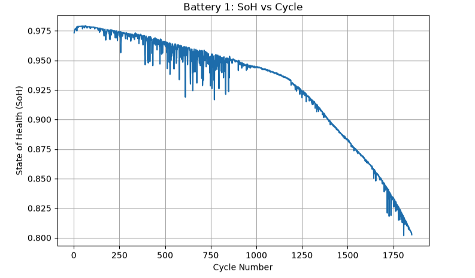
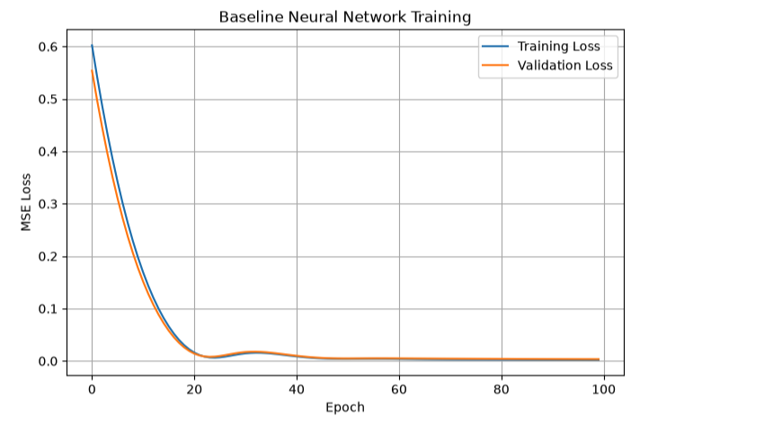
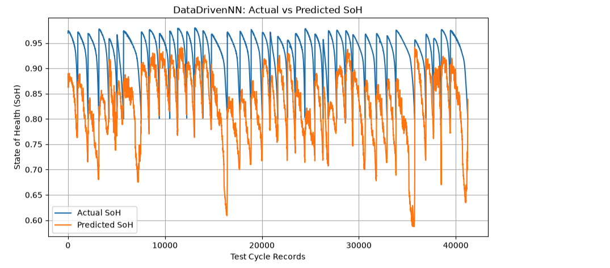
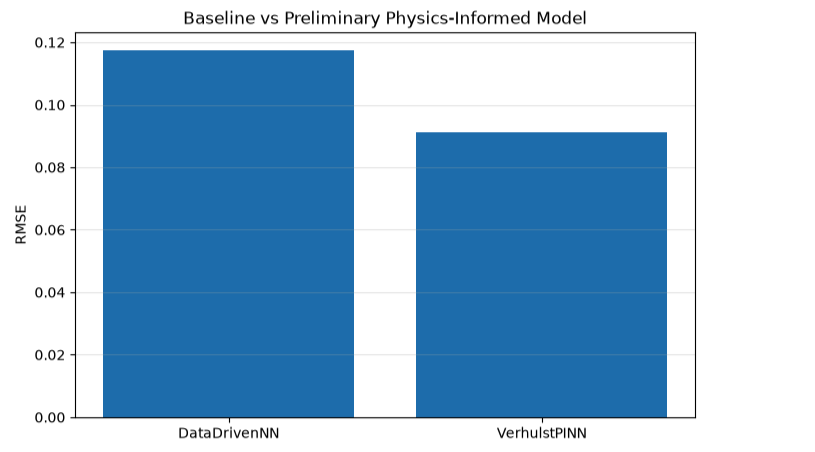

The Severson dataset contains 124 LFP/graphite lithium-ion cells, with multiple charge-discharge cycles recorded for each cell. Since individual cycle records from the same battery are highly correlated, we avoid randomly splitting individual cycles because that can cause data leakage. Instead, we perform the train, validation and test split at the battery level, so all cycles from a particular battery remain in the same subset. The training batteries are used to learn the degradation relationship, validation batteries are used for model development and tuning, and completely unseen test batteries are reserved for the final evaluation.

This graph shows the degradation behavior of an individual lithium-ion battery over its cycling lifetime. We can observe how the State of Health changes as the number of charge-discharge cycles increases. The decreasing trend indicates capacity degradation with repeated cycling. This preliminary analysis helps us establish the relationship between battery usage and health before applying machine-learning models.

<!-- this is the soh vs cycle image -->

Before training the neural network, we first analyzed the underlying degradation behavior in the dataset. This allows us to verify that the processed data preserves the expected physical behavior of battery aging.

The next stage is to use the extracted battery-health features as inputs to a baseline neural network and evaluate whether the model can learn this degradation behavior and predict battery health.

After preparing the eight engineered battery features, we implemented a baseline data-driven neural network. The model was trained using the processed battery dataset, and the training and validation MSE were monitored over 100 epochs. The loss decreases significantly during the initial epochs and then stabilizes, indicating that the network is learning the underlying relationship in the data.
<!-- this is the baseline nn training graph which shows training loss and validation loss -->

This is our baseline model. 

<!-- this is the image of data driven nn : actual vs predicted soh  -->

This graph compares the actual SoH values from the test batteries with the SoH predicted by our baseline DataDrivenNN. The purpose is to visually assess how closely the model follows the actual battery degradation trajectory.

<!-- 
this is the image of baseline vs preliminary physics informed nn -->

This is our preliminary comparison between the purely data-driven neural network and the physics-informed model. The baseline DataDrivenNN achieved an RMSE of approximately 0.117, whereas after introducing the Verhulst physics constraint, the preliminary PINN achieved an RMSE of approximately 0.091. Since lower RMSE indicates lower prediction error, this represents roughly a 22% reduction in RMSE in our current experiment.

This is only our initial physics-informed formulation. We haven't considered this the final model yet. In the next stage, we plan to tune the physics-loss weighting, calibrate the degradation parameters, improve the physics formulation and then evaluate RUL prediction and the DeepHPM model.

